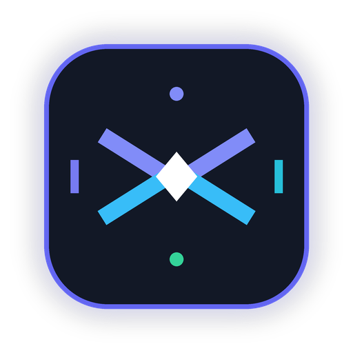

# Compressify — Image Compressor

<p align="center">
  
</p>

<p align="center">
  <b>Reduce image size. Keep the quality.</b><br>
  A fast, lightweight, 100% offline-first Android image compressor built with Jetpack Compose & Material 3.
</p>

<p align="center">
  
  
  
  
  
  
</p>

---

## 🌟 Overview

**Compressify** is designed under one core principle:
> **ONE APP → ONE PROBLEM → ONE EXCELLENT SOLUTION**

Users often face strict file-size limits when uploading documents, submitting government or university forms, sending photos over slow connections, or conserving phone storage. Compressify solves this in **3–4 taps** with no account, no cloud uploads, and no ads interfering with the workflow.

---

## ✨ Features

- **100% Offline & Private**: Zero server uploads, zero cloud dependencies. No `android.permission.INTERNET` requested.
- **Modern Photo Picker**: Native Android PhotoPicker (`ActivityResultContracts.PickVisualMedia`) for safe single-image selection without asking for broad device storage permissions.
- **High Visual Quality**: Smart downsampling and dynamic JPEG/WebP compression to maximize size savings while preserving image fidelity.
- **Three One-Tap Presets**:
  - **High Quality**: Quality 90%, 100% scale — Best visual quality with moderate size reduction.
  - **Balanced (Default)**: Quality 78%, smart 85% scale — Optimal balance of quality and storage savings.
  - **Small Size**: Quality 55%, smart 70% scale — Maximum file reduction for strict upload limits.
- **Advanced Custom Slider**: Fine-tune quality from 10% to 100% with live percentage badge.
- **Instant Result Screen**:
  - Exact before and after file sizes (e.g., `4.8 MB` → `780 KB`).
  - Clear percentage saved badge (e.g., `84% smaller`).
  - Original and compressed resolutions.
  - Interactive before/after visual comparison viewer.
- **Scoped Storage & Native Sharing**:
  - Saves directly to public `Pictures/Compressify` using Android `MediaStore` (Scoped Storage compliant on Android 10–14+).
  - Native Android share sheet via secure `FileProvider` content URIs.
- **Large Image Safety**: Subsampling (`inJustDecodeBounds` + sample size calculation) and memory-conscious streams prevent Out-of-Memory (OOM) errors even on 48MP–108MP camera photos.
- **EXIF Orientation Correction**: Automatically fixes orientation so portrait photos never end up rotated.
- **PNG Transparency Preservation**: Intelligently preserves alpha transparency on PNG/WebP images.
- **Material 3 Design**: Complete dynamic color support, sleek dark mode, and accessible typography.

---

## 🏗️ Architecture & Technology Stack

- **Pattern**: MVVM (Model-View-ViewModel) + Single-Activity Architecture + Repository Pattern
- **Language**: Kotlin 1.9.24
- **UI Toolkit**: Jetpack Compose with Material 3 (BOM 2024.05.00)
- **Asynchronous Processing**: Kotlin Coroutines & `StateFlow`
- **Image Rendering**: Coil Compose 2.6.0
- **Metadata & EXIF**: AndroidX ExifInterface 1.3.7
- **Build System**: Gradle 8.7 + Android Gradle Plugin 8.4.2 (Kotlin DSL)

### Project Structure

```
com.compressify.app
├── MainActivity.kt               # Single Activity host with animated navigation
├── CompressifyApp.kt             # Application class
├── data
│   ├── model
│   │   ├── CompressionPreset.kt  # High Quality, Balanced, Small Size, Custom
│   │   ├── CompressionConfig.kt  # Preset & quality configuration
│   │   ├── ImageMetadata.kt      # Dimension, orientation, file size, mime type
│   │   ├── CompressionResult.kt  # Metrics: before/after size, % saved, duration
│   │   └── ThemeMode.kt          # System Default, Light, Dark
│   ├── repository
│   │   └── PreferencesRepository.kt # Settings persistence (SharedPreferences)
│   └── storage
│       └── FileStorageManager.kt    # MediaStore insertion & FileProvider sharing
├── domain
│   └── compressor
│       ├── ImageCompressor.kt       # Interface
│       └── ImageCompressorImpl.kt   # Safe decoding, EXIF rotation & compression
├── ui
│   ├── theme
│   │   ├── Color.kt             # Curated palette (Electric Indigo, Sky, Emerald)
│   │   ├── Type.kt              # Material 3 typography
│   │   └── Theme.kt             # CompressifyTheme with dynamic color
│   ├── navigation
│   │   └── Screen.kt            # Home, Preview, Result, Settings
│   ├── home
│   │   └── HomeScreen.kt        # Hero branding, CTA, offline badges
│   ├── preview
│   │   └── PreviewScreen.kt     # Image preview, preset cards, custom slider
│   ├── result
│   │   └── ResultScreen.kt      # Before/After stats, savings badge, Save/Share
│   ├── settings
│   │   └── SettingsScreen.kt    # Themes, default preset, privacy policy dialog
│   ├── components
│   │   ├── AppTopBar.kt         # Consistent header app bar
│   │   ├── PresetCard.kt        # Selectable preset card with radio indicator
│   │   ├── QualitySlider.kt     # Expandable custom quality slider
│   │   ├── ComparisonViewer.kt  # Tabbed before/after visual comparison
│   │   └── PrivacyDialog.kt     # Plain-language offline privacy dialog
│   └── viewmodel
│       └── CompressorViewModel.kt # StateFlow-driven MVVM state machine
└── utils
    ├── FileUtils.kt             # URI metadata extraction, cache, naming
    └── Formatters.kt            # Human-readable byte formatting (KB/MB)
```

---

## 🔒 Privacy Approach

Privacy is Compressify's primary selling point:
- **No Internet Permission**: The app doesn't declare `android.permission.INTERNET` in `AndroidManifest.xml`. It cannot connect to the internet even if it tried.
- **Local Memory Processing**: Bitmaps are decoded into local volatile memory, compressed, and written only to the local app cache or user's `Pictures/Compressify` directory.
- **No Analytics / No Tracking**: No user data, device IDs, or photo contents are ever stored or transmitted.

---

## 🧪 Testing

### Automated Unit Tests

Execute unit tests with Gradle:
```bash
./gradlew test
```

Included test suites:
1. `FormattersTest`: Validates byte conversion (`B`, `KB`, `MB`, `GB`), zero/negative safety, and percentage saved clamping.
2. `FileUtilsTest`: Validates sanitized compressed filename generation (`_compressed.jpg`), extension preservation, and timestamp fallbacks.
3. `CompressionPresetTest`: Validates default qualities, dimension constraints, and default configuration integrity.

---

## 🚀 Building & Releasing

### Prerequisites
- JDK 17 (Eclipse Temurin or OpenJDK 17)
- Android SDK 34 (`platforms;android-34`, `build-tools;34.0.0`)

### Build Debug APK
```bash
./gradlew assembleDebug
```
Output: `app/build/outputs/apk/debug/app-debug.apk`

### Build Production Release AAB (Android App Bundle)
```bash
./gradlew bundleRelease
```
Output: `app/build/outputs/bundle/release/app-release.aab`

---

## 📄 License

Licensed under the Apache License 2.0. See LICENSE for details.

